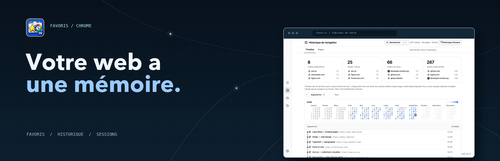
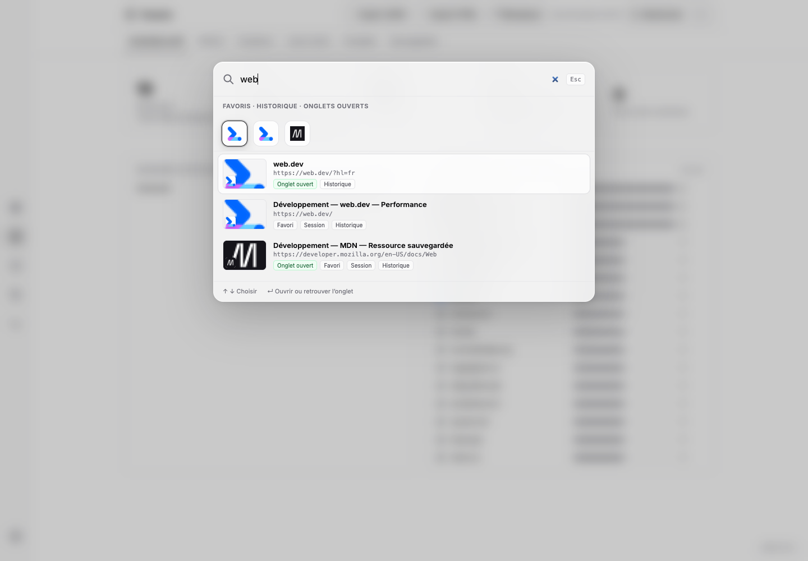
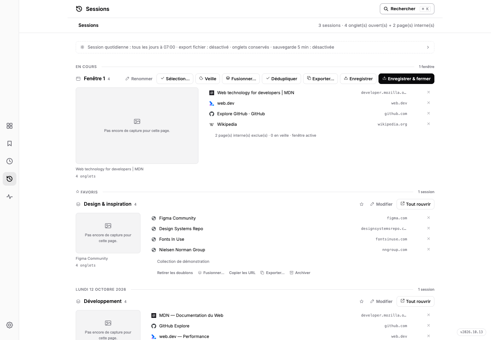

# PK Web Memory




[🇫🇷 Français](README.md) · [🇬🇧 English](README.en.md)

Votre vie web, organisée : **favoris, historique, sessions et liens utiles réunis dans un seul espace.** Extension Chrome sans build step ni dépendance. Version **2026.10.17**.

## Aperçu





La [landing bilingue](store/website/index.html) détecte la langue du navigateur (français ou anglais) et propose une bascule manuelle. Elle comprend huit captures réelles agrandissables et un playground pleine largeur qui reconstitue le tableau de bord avec des données fictives : palette ⌘K, inventaire, galerie, doublons, sessions, historique et instantanés. La simulation et les captures montrent l'interface originale de l'extension en français ; miniatures et favicônes sont chargées via mshots et Google S2, comme dans l'extension. Le playground n'est pas l'extension embarquée.

Pour la consulter : `python3 -m http.server 4174 --bind 127.0.0.1`, puis ouvrir `http://127.0.0.1:4174/store/website/`.

Régénération des captures : `node store/website/tools/capture.mjs` (Node 22+ et Chrome for Testing ; chemin configurable avec `CHROME_BIN`). Le script charge `extension/` dans un profil headless jetable, crée des favoris, visites et sessions de démonstration via les API Chrome, puis capture l'interface sans retouche du DOM, des styles ou des images. Galerie en mode favicônes ; liens morts avant scan, sans faux résultats. Les exports de sauvegarde restent dans le profil temporaire, supprimé à la fin. Le [rapport de provenance](store/website/tools/capture-report.json) conserve les dimensions, la version et les empreintes des sources et PNG.

## Installation (mode développeur)

1. Ouvre `chrome://extensions`
2. Active **Mode développeur** (en haut à droite)
3. Clique **Charger l'extension non empaquetée** → sélectionne le dossier `extension/`
4. Clique l'icône de l'extension dans la barre d'outils → le dashboard s'ouvre

## Fonctionnalités

| Onglet | Ce que ça fait |
|---|---|
| **Tableau de bord** | Vos liens utiles, rangés par catégorie : une vue à plat sur un dossier de favoris Chrome (« Catégorie — Titre » : le préfixe fait la catégorie, sans préfixe le lien reste en « Sans catégorie » ; favoris = liens avec favicons, aperçu de la page au survol, liens morts barrés). Deux affichages au choix dans la barre : **Liste** (par défaut, un index typographique dense — boîtes au filet hairline, liens soulignés qui s'assombrissent au survol) ou **Cartes** (se partageant la largeur selon leur nombre) ; poignée d'élargissement et titre tiré pour déplacer dans les deux modes, rappel discret en pied de page. Ajout de l'onglet courant ou d'un lien à la main, renommage en place (double-clic ou crayon visible), réordonnancement et changement de catégorie par glisser-déposer, filtre de recherche — les sous-dossiers hérités sont aplatis d'un coup (le nom du dossier devient le préfixe) ; la même liste que dans le gestionnaire de favoris Chrome, et les suppressions partent à la poubelle de l'app |
| **Recherche globale** | ⌘K ou n'importe quelle frappe : palette façon Spotlight qui cherche dans les favoris, l'historique et les onglets ouverts ; ↵ ouvre le site ou retrouve son onglet |
| **Historique de navigation** | Timeline et pages consultées, filtrables par jour et par période. Archive locale facultative (activée par défaut) : importe ce que Chrome conserve encore et garde les visites futures au-delà de sa fenêtre ; réglage pour l'arrêter et commande pour effacer l'archive. Raccourcis paramétrables pour chaque onglet du rail — défauts ⌥⇧D tableau de bord, ⌥⇧B favoris, ⌥⇧H historique, Sessions/Ressources/Réglages à définir au choix ; l'infobulle de l'onglet montre la combinaison en vigueur |
| **Inventaire** | Totaux, classement des chemins de dossiers et des domaines, avec barres de fréquence et favicons |
| **Galerie** | Miniatures mshots ou liste compacte inspirée du gestionnaire de favoris Chrome, avec recherche, filtre par dossier, compteur affichés/total, choix des colonnes et cache local de 30 jours |
| **Doublons** | 3 niveaux : 1 · URL stricte · 2 · sans tracking (utm, fbclid…) · 3 · sans http/https, www et params |
| **Liens morts** | Scan parallèle ; seuls les HTTP 404/410 confirmés sont morts, les erreurs temporaires restent à vérifier |
| **Sessions** | Timeline fusionnée façon Tablerone : session en cours toujours dépliée, croix par ligne (fermer l'onglet ou retirer le lien, annulable), aperçu de page au survol, vue élargie au clic, enregistrement & fermeture, enregistrement de sélection, dédoublonnage des onglets ouverts (annulable), carte « Reprendre » à tab zéro, export URL/titres/Markdown/HTML/CSV/JSON (copie ou fichier), sauvegarde auto 5 min, mise en veille des onglets inactifs (URL d'origine conservée, badge Zzz, récap et réveil en un clic), session quotidienne programmée à l'heure choisie — **active par défaut à 07:00** — avec export fichier JSON optionnel dans le dossier de téléchargements (`PK Web Memory/`, synchronisable Google Drive), **copie de secours `sessions-backup.json`** (fichier unique écrasé : 2 min après une action manuelle, au plus 1×/heure en automatique ; survit à une désinstallation, réimportable en un clic), **récupération des fenêtres/onglets récemment fermés** et rappel du planning en tête d'onglet, cliquable vers ses réglages |
| **Backup** | Exports JSON/HTML des favoris actifs, historique local d'instantanés reliés, gestion de la quarantaine |
| **Ressources** | Heap JS live par onglet + réseau téléchargé depuis le chargement : intervalle réglable (1 s / 2 s / 5 s / pause), barre de poids, tendance ↗/↘/→ au survol (heap JS ≈ ⅓ de l'empreinte mémoire Chrome), position de défilement conservée, activation au clic ; même moniteur en panneau latéral Chrome (clic droit sur l'icône), heap de l'extension inclus |
| **Pastille icône** | Nombre d'onglets ouverts ou d'onglets en double affiché sur l'icône (au choix dans les réglages) |
| **Page d'accueil** | Ctrl+T ouvre l'extension sur la section choisie (tableau de bord, sessions, galerie, historique…) |

## Sécurité

Les captures de la galerie sont demandées à WordPress.com mshots ; l’URL du site est transmise à ce service. Les images récupérées sont conservées dans le stockage local de l’extension pendant 30 jours (maximum 60 entrées), puis régénérées à la demande. Certaines favicônes de secours utilisent Google S2 ; les scans de liens contactent les sites vérifiés sans transmettre leurs cookies.

Le Tableau de bord ne crée pas de stockage de liens parallèle : il lit et modifie directement le dossier de favoris Chrome que vous désignez, et n'enregistre que ce choix de dossier. Aucune donnée ne part ailleurs. Un lien supprimé depuis la page suit le même chemin que les autres nettoyages : instantané local, entrée à la poubelle de l'app, puis retrait du favori.

Les sessions et réglages sont stockés localement. Consultez la [politique de confidentialité](store/privacy-policy.html) et la [fiche Chrome Web Store](store2/description-store.md) pour le détail des traitements et permissions.

Les liens ne sont proposés à la quarantaine qu’après 30 jours avec un statut 404/410 confirmé. Un rescannage qui les trouve vivants ou échoue temporairement réinitialise le délai. Les nettoyages déplacent les bookmarks vers `Quarantaine — Bookmarks Sorter`, avec motif et statut. Un lien mort est supprimé automatiquement après 30 jours en quarantaine ; s’il répond de nouveau pendant ce délai, il est signalé pour restauration. Les doublons restent restaurables jusqu’à une purge manuelle.

Chaque export, nettoyage, restauration ou purge conserve un instantané local dans l’historique (jusqu’à 30 versions), relié au précédent. Restaurer un instantané rétablit les favoris manquants sans supprimer les favoris plus récents. Les exports JSON/HTML sont des fichiers téléchargés par Chrome, séparés de cet historique.

Les doublons gardent toujours le bookmark le plus ancien. Les pages `chrome://` et fichiers locaux ne sont jamais scannées.

## Structure

```
extension/    ← l'extension Chrome (manifest.json, index.html, style.css, app.js, sw.js)
store/        ← fiche Chrome Web Store, assets promo et politique de confidentialité
store2/       ← ancien kit web et landing
store3/       ← ancienne direction visuelle premium
store/website/ ← landing bilingue actuelle, playground interactif et captures réelles
src/          ← pipeline Python complémentaire (stdlib : stats + dédoublonnage CLI)
archive/      ← anciennes versions : src3 (fusion sessions), premier site du store
data/         ← exports et fichiers de travail
backups/      ← archives horodatées
```

## Conventions

- Zéro dépendance : vanilla JS côté extension, stdlib Python côté CLI.
- Racine minimale, pas de `node_modules`, pas de build.
- Chaque dump destiné à être testé reçoit une nouvelle version `YYYY.MM.N`, même pour une petite modification. Lance `python3 scripts/bump_version.py`, puis recharge l'extension non empaquetée dans `chrome://extensions`.
- Chrome exige une version numérique sans zéro initial dans le manifest : `version` utilise donc `YYYY.M.N` (par exemple `2026.9.4`). `version_name` conserve l'affichage lisible `YYYY.MM.N` (par exemple `2026.09.4`), montré dans l'en-tête de l'extension. Voir `CHANGELOG.md` pour l'historique.
- Voir le [CHANGELOG](CHANGELOG.md) pour l'historique complet.
- Tests : `node --test "extension/tests/*.test.mjs"`. Le test du Tableau de bord charge la vraie extension dans un profil Chrome jetable (Chrome for Testing requis, chemin imposable par `CHROME_BIN` ; sans lui il est ignoré). Captures facultatives avec `DASHBOARD_SHOTS=<dossier>`.

## Soutenir

Un café aide à faire vivre le projet : [Ko-fi](https://ko-fi.com/pouark).
