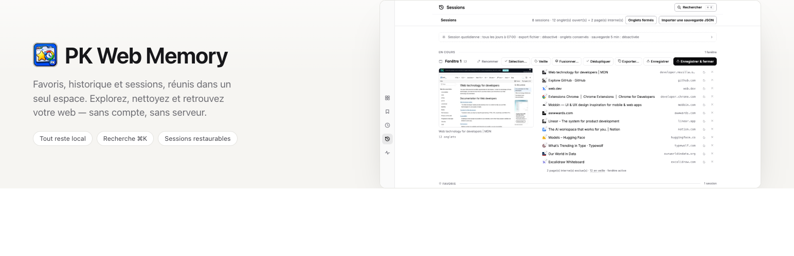
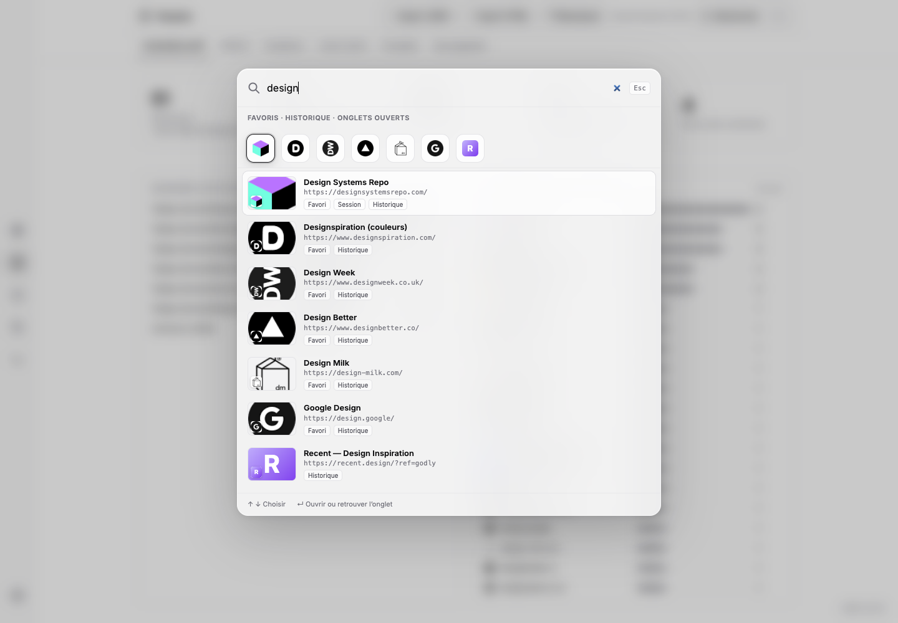
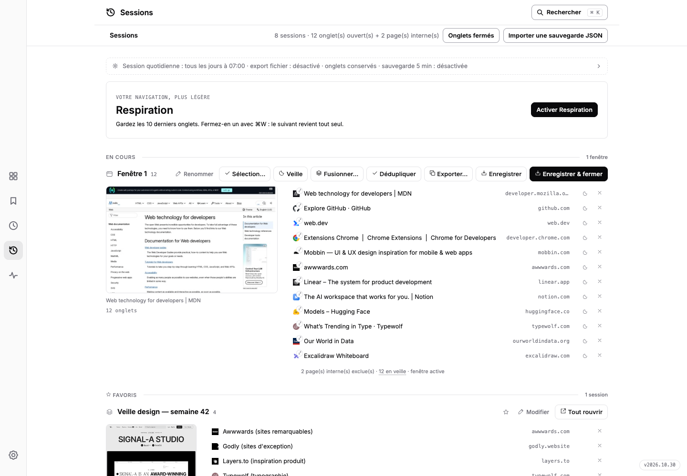
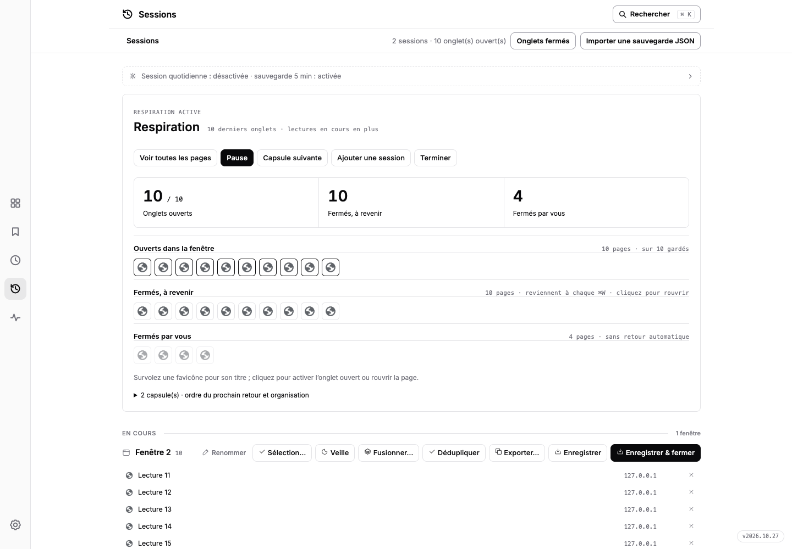
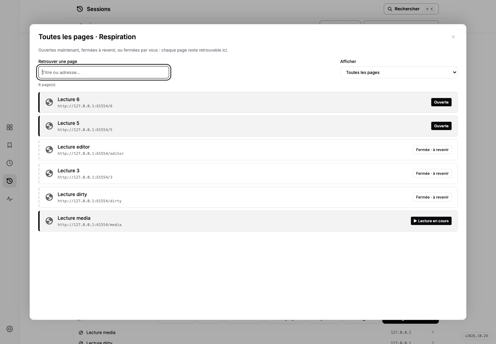

# PK Web Memory




[🇫🇷 Français](README.md) · [🇬🇧 English](README.en.md)

Votre vie web, organisée : **favoris, historique, sessions et liens utiles réunis dans un seul espace.** Extension Chrome sans étape de build ni dépendance distante à installer. Version **2026.10.59**.

## Aperçu





La [landing bilingue](store/website/index.html) détecte la langue du navigateur (français ou anglais) et propose une bascule manuelle. Elle comprend neuf captures réelles agrandissables et un playground pleine largeur qui reconstitue le tableau de bord avec des données fictives : palette ⌘K, inventaire, galerie, doublons, sessions, historique et instantanés. La simulation et les captures montrent l'interface originale de l'extension en français ; miniatures et favicônes sont chargées via mshots et Google S2, comme dans l'extension. Le playground n'est pas l'extension embarquée.

Pour la consulter : `python3 -m http.server 4174 --bind 127.0.0.1`, puis ouvrir `http://127.0.0.1:4174/store/website/`.

Régénération des captures : `node store/website/tools/capture.mjs` (Node 22+ et Chrome for Testing ; chemin configurable avec `CHROME_BIN`). Le script charge `extension/` dans un profil headless jetable, crée des favoris, visites et sessions de démonstration via les API Chrome, puis capture l'interface sans retouche du DOM, des styles ou des images. Galerie en mode favicônes ; liens morts avant scan, sans faux résultats. Les exports de sauvegarde restent dans le profil temporaire, supprimé à la fin. Le [rapport de provenance](store/website/tools/capture-report.json) conserve les dimensions, la version et les empreintes des sources et PNG.

Le kit média v4 (`store/v4/`) est la vitrine actuelle : cinq captures 1280×800 pour la fiche Chrome Web Store, neuf scènes 1440×1000 pour la landing, la tuile, le marquee, la bannière et la carte OG, un GIF large + compact et un MP4 de démonstration. Régénération : `node store/v4/tools/capture-v4.mjs` puis `bash store/v4/tools/build-media.sh` — méthode, sources et limites dans le [README du kit](store/v4/media-kit/README.md).

## Installation (mode développeur)

1. Ouvre `chrome://extensions`
2. Active **Mode développeur** (en haut à droite)
3. Clique **Charger l'extension non empaquetée** → sélectionne le dossier `extension/`
4. Clique l'icône de l'extension dans la barre d'outils → le dashboard s'ouvre

## Fonctionnalités

| Onglet | Ce que ça fait |
|---|---|
| **Tableau de bord** | Vos liens utiles, rangés par catégorie : une vue à plat sur un dossier de favoris Chrome (« Catégorie — Titre » : le préfixe fait la catégorie, sans préfixe le lien reste en « Sans catégorie » ; favoris = liens avec favicons, aperçu de la page au survol, liens morts barrés). Deux affichages au choix dans la barre : **Liste** (par défaut, un index typographique dense — boîtes au filet hairline, liens soulignés qui s'assombrissent au survol) ou **Cartes** (se partageant la largeur selon leur nombre) ; poignée d'élargissement et titre tiré pour déplacer dans les deux modes, rappel discret en pied de page. Ajout de l'onglet courant ou d'un lien à la main, renommage en place (double-clic ou crayon visible), réordonnancement et changement de catégorie par glisser-déposer, filtre de recherche — les sous-dossiers hérités sont aplatis d'un coup (le nom du dossier devient le préfixe) ; la même liste que dans le gestionnaire de favoris Chrome, et les suppressions partent à la poubelle de l'app |
| **Recherche globale** | ⌘K ou n'importe quelle frappe : palette façon Spotlight qui cherche dans les favoris, l'historique et les onglets ouverts ; ↵ ouvre le site ou retrouve son onglet |
| **Historique de navigation** | Timeline et pages consultées, filtrables par jour et par période. Archive locale facultative (activée par défaut) : importe ce que Chrome conserve encore et garde les visites futures au-delà de sa fenêtre ; réglage pour l'arrêter et commande pour effacer l'archive. Raccourcis paramétrables pour chaque onglet du rail — défauts ⌥⇧D tableau de bord, ⌥⇧B favoris, ⌥⇧H historique, Sessions/Ressources/Mots de passe/Réglages à définir au choix ; l'infobulle de l'onglet montre la combinaison en vigueur |
| **Inventaire** | Totaux, classement des chemins de dossiers et des domaines, avec barres de fréquence et favicons |
| **Galerie** | Miniatures mshots ou liste compacte inspirée du gestionnaire de favoris Chrome, avec recherche, filtre par dossier, compteur affichés/total, choix des colonnes et cache local de 30 jours |
| **Doublons** | 3 niveaux : 1 · URL stricte · 2 · sans tracking (utm, fbclid…) · 3 · sans http/https, www et params |
| **Liens morts** | Scan parallèle ; seuls les HTTP 404/410 confirmés sont morts, les erreurs temporaires restent à vérifier |
| **Sessions** | Timeline fusionnée façon Tablerone : session en cours toujours dépliée, croix par ligne (fermer l'onglet ou retirer le lien, annulable), aperçu de page au survol, vue élargie au clic, enregistrement & fermeture, enregistrement de sélection, dédoublonnage des onglets ouverts (annulable), carte « Reprendre » à tab zéro, export URL/titres/Markdown/HTML/CSV/JSON, sauvegarde auto 5 min, mise en veille des onglets inactifs, session quotidienne à 07:00 par défaut, récupération des fenêtres/onglets récemment fermés. La base SQLite locale conserve visites archivées, pages et sessions dans un seul fichier choisi par l'utilisateur sous Application Support ; après réinstallation, reconnecter ce fichier restaure les sessions. |
| **Backup** | Exports JSON/HTML des favoris actifs, historique local d'instantanés reliés, gestion de la quarantaine |
| **Ressources** | Heap JS live par onglet + réseau téléchargé depuis le chargement : intervalle réglable (1 s / 2 s / 5 s / pause), barre de poids, tendance ↗/↘/→ au survol (heap JS ≈ ⅓ de l'empreinte mémoire Chrome), position de défilement conservée, activation au clic ; même moniteur en panneau latéral Chrome (clic droit sur l'icône), heap de l'extension inclus |
| **Mots de passe** | Accès direct au gestionnaire de mots de passe de Chrome et Google depuis le rail (icône clé) : panneau de lancement qui ouvre le gestionnaire natif dans un nouvel onglet — la page reste ouverte en dessous — ou la version web passwords.google.com ; raccourci de section paramétrable ; l'extension n'a jamais accès aux mots de passe (règle Chrome) |
| **Pastille icône** | Nombre d'onglets **web** ouverts, onglets en double, **ou indicateur du mode Respiration** — ▶ vert en marche, ⏸ orange en pause — portée **fenêtre de la tournée** par défaut ou toutes les fenêtres ; pages internes de l'extension, PWA, popups et fenêtres privées exclus (au choix dans les réglages) |
| **Page d'accueil** | Ctrl+T ouvre l'extension sur la section choisie (tableau de bord, sessions, galerie, historique…) |

## Respiration : 10 onglets ouverts, un point c'est tout





Dans **Sessions → Activer Respiration**, choisissez une fenêtre et le nombre d’onglets web à garder (10 par défaut, de 1 à 30). **Seuls les N derniers onglets de la fenêtre restent ouverts ; tout le reste est sauvegardé puis fermé.** La seule exception : une **lecture en cours (vidéo ou audio)**, conservée en plus de la cible puis fermée quand elle s’arrête. Avec 100 pages, vous gardez 91 à 100 : fermer 100 fait revenir 90 à gauche, fermer 99 fait revenir 89, sans prendre le focus. L’ordre est celui des onglets, pas celui des dernières consultations.

**Deux modes :** **Fermer** (par défaut) sauvegarde puis ferme les pages, pour une mémoire minimale. **Suspendre** utilise le mécanisme natif de Chrome (`chrome.tabs.discard`) : tous les onglets restent visibles dans la barre Chrome avec leur vrai titre et leur favicon, seuls les N plus récents restent chargés, les autres sont suspendus et se rechargent au clic. L’onglet actif, les épinglés et les lectures peuvent rester chargés au-delà de la cible. Chrome conserve environ 1 à 5 Mo de métadonnées par onglet suspendu : le mode Fermer reste le plus économe en mémoire. Changer de mode dans les Réglages s’applique immédiatement à la tournée en cours : passer en Fermer sauvegarde et ferme les onglets en trop ; passer en Suspendre les endort. La carte Respiration affiche les deux modes côte à côte : cliquer sur l’un applique le choix à la tournée en cours, et recliquer le mode actif relance la réduction. Le bouton **« Rouvrir en mode Suspendre »** recrée les pages « à revenir » dans Chrome et les suspend aussitôt ; il est disponible dans la carte Respiration de Sessions **et au bas de la section « À revenir » du panneau latéral** (« Rouvrir N pages à revenir en suspendu »). Les pages sont ajoutées après les onglets ouverts, puis suspendues par lots de trois après chargement ; le message final indique combien sont réellement suspendues et combien restent chargées. Si des onglets sont déjà restés blancs, le panneau propose **« Réparer N onglet(s) suspendu(s) vide(s) »** : il remet l’URL de la file, recharge et suspend.

Le panneau affiche trois compteurs et autant de sections, à la même lecture : **Onglets ouverts** (x / cible, lectures en cours en plus) avec la grille des onglets réellement ouverts — un clic les active ; **Fermés, à revenir** — les pages sauvegardées puis fermées, chacune revient au prochain ⌘W, un clic la rouvre ; **Fermés par vous** — les pages retirées de la tournée, sans retour automatique. Chaque page est une favicône (survol ou focus clavier : titre complet, URL et vignette) et **toutes les pages de la section sont affichées**, pas un échantillon. L’aperçu utilise la capture locale disponible, puis le service de miniatures si ce réglage est activé ; sinon il indique que la vignette est indisponible. Aucun onglet n’est rouvert au survol. « Toutes les pages » ouvre la liste complète dans le panneau latéral de Chrome : titre, URL complète, groupes par état et recherche, mise à jour en direct.

Les groupes Chrome et les pages non groupées forment des **lots de pages**. Ils ne servent qu’à une chose : l’ordre de retour. Une ligne annonce la **prochaine page qui revient au prochain ⌘W** ; le repli « Ordre de retour » n’apparaît que s’il y a plusieurs lots (un groupe Chrome, les onglets de la fenêtre…) et permet de les remonter/descendre ou de passer au lot suivant. Les pages ouvertes après le lancement rejoignent le lot de la fenêtre — plus de doublon « Pages ajoutées à la fenêtre » ; les anciennes files sont fusionnées au rechargement. Une page ouverte manuellement fait partie du même budget : sauvegardée, puis la plus ancienne des N dernières sort au contrôle suivant (30 s) — jamais au milieu d’une restauration. **Mettre en pause** arrête le remplissage ; **Arrêter la tournée** la désactive sans fermer les pages ouvertes ni supprimer les sessions.

**Enregistrez vos brouillons avant d’activer** : formulaires modifiés, éditeurs remplis, onglets actifs et épinglés sont fermés comme les autres s’ils ne sont pas dans les N derniers — les sauvegardes conservent les liens et métadonnées, pas les saisies. Les pages internes Chrome (chrome://, newtab…) restent ouvertes et hors budget.

**Accès rapide :** le clic gauche sur l’icône de l’extension ouvre directement le panneau latéral ; le clic droit propose le panneau, la page complète et un nouvel onglet Sessions. ⌘T/Ctrl+T reste sur la page nouvel onglet configurée (Sessions par défaut), et le lien « Gérer la tournée dans Sessions » reste dans le panneau.

**Roulement manuel :** ouvrez « Toutes les pages » dans Respiration et choisissez une ancienne page dans la réserve (recherche par titre ou URL). Elle devient active ; si la cible est atteinte, l’onglet le moins récemment utilisé, hors lecture audio/vidéo, est sauvegardé puis fermé et reste « À revenir ». Ce clic fonctionne aussi dans les grilles et le panneau latéral. Un échange ne marque aucune page comme traitée ; **⌘W signifie « fini »** et rappelle la suivante en arrière-plan. Le choix manuel reste utilisable en pause, sans relancer le remplissage automatique. Le panneau conserve l’accès au moniteur via « Ressources », activé seulement quand cette vue est affichée. Une création d’onglet refusée laisse les pages déjà ouvertes intactes ; si la fenêtre de la tournée a disparu, reprenez-la d’abord depuis Sessions.

**Barre d’onglets :** le rail favicon affiche toute la réserve dans une liste défilante ; il est **désactivé par défaut** et s’active dans Réglages → Sessions & onglets → « Rail favicon sur le bord des pages ». Le panneau latéral propose deux affichages : liste détaillée ou **mosaïque de favicons** groupée par état. Le pictogramme réglages du panneau (curseurs) donne aussi accès au rail, au mode Respiration et à la pastille sans quitter le panneau. **⇄** le déplace à gauche ou à droite, **⛶** bascule la fenêtre en plein écran — Chrome ne permet pas de masquer uniquement sa barre d’onglets, le plein écran efface donc toute l’interface du navigateur et laisse le rail dans la page — et **☰** ouvre le panneau latéral détaillé. F11 ou ⌃⌘F rétablit la barre. Le rail reste masqué dans les fenêtres sans onglets Chrome (applications installées/PWA, popups) ; l’option « Rail favicon dans les fenêtres d’application » des Réglages permet de l’y réafficher.

**⌘⌥W (Commande + Option + W) signifie « à revenir »** : depuis la page web active de la tournée, ferme cet onglet sans le marquer traité, le remet derrière toute la réserve et rappelle une autre page en arrière-plan. Les lectures en cours sont conservées ; en pause, la page est rangée sans remplissage. Sans autre page en réserve, elle n’est pas rouverte immédiatement ; le dernier onglet de la fenêtre reste ouvert s’il n’y a aucun remplaçant. La fermeture n’a lieu qu’après sauvegarde, et un échec d’ouverture conserve l’onglet courant.

Le raccourci est détecté dans les pages HTTP(S), y compris leurs cadres intégrés : cliquez dans la page si le focus est dans la barre d’adresse. Il ne s’applique pas à l’interface Chrome, aux pages protégées du Store ou aux fichiers locaux. Après une mise à jour, rechargez l’extension via **↻** : l’écoute est réinstallée dans les pages déjà ouvertes, sans réinstallation de l’extension. Chrome refuse ce couple de modificateurs dans `commands`, pas dans un événement clavier de page ; aucun réglage dans `chrome://extensions/shortcuts` n’est requis pour ⌘⌥W. Un raccourci navigateur facultatif peut toujours y être assigné.

La tournée est attachée à **une fenêtre à la fois**. Fermer cette fenêtre, déplacer un onglet, effectuer une fermeture groupée depuis l’extension ou redémarrer Chrome met le remplissage en pause. Après rechargement de l’extension, « Reprendre » retrouve la fenêtre d’origine si ses onglets sont encore identifiables, puis réduit les pages en trop. Aucune fenêtre n’est recréée automatiquement. La file est persistée et relue avant chaque fermeture ; les capsules restent des sessions ordinaires exportables. La sauvegarde SQLite inclut aussi la progression si un fichier est connecté. Un dashboard resté ouvert sur une version antérieure affiche une consigne de rechargement au lieu de l’erreur « Commande Respiration inconnue ».

Vérification : `node --test extension/tests/respiration.test.mjs extension/tests/respiration.browser.test.mjs`. Le test navigateur utilise Chrome for Testing, un profil jetable et des pages locales ; `RESPIRATION_SHOTS=/tmp/respiration-shots` produit des captures réelles desktop/mobile.

## Sécurité

Les captures de la galerie sont demandées à WordPress.com mshots ; l’URL du site est transmise à ce service. Les images récupérées sont conservées dans le stockage local de l’extension pendant 30 jours (maximum 60 entrées), puis régénérées à la demande. Certaines favicônes de secours utilisent Google S2 ; les scans de liens contactent les sites vérifiés sans transmettre leurs cookies.

Le Tableau de bord ne crée pas de stockage de liens parallèle : il lit et modifie directement le dossier de favoris Chrome que vous désignez, et n'enregistre que ce choix de dossier. Aucune donnée ne part ailleurs. Un lien supprimé depuis la page suit le même chemin que les autres nettoyages : instantané local, entrée à la poubelle de l'app, puis retrait du favori.

Les sessions et réglages sont stockés localement. Consultez la [politique de confidentialité](store/privacy-policy.html) et la [fiche Chrome Web Store](https://chromewebstore.google.com/detail/pk-web-memory/bpbbglmebdopkbmgpehloggencjmfbcd) pour le détail des traitements et permissions.

Les liens ne sont proposés à la quarantaine qu’après 30 jours avec un statut 404/410 confirmé. Un rescannage qui les trouve vivants ou échoue temporairement réinitialise le délai. Les nettoyages déplacent les bookmarks vers `Quarantaine — Bookmarks Sorter`, avec motif et statut. Un lien mort est supprimé automatiquement après 30 jours en quarantaine ; s’il répond de nouveau pendant ce délai, il est signalé pour restauration. Les doublons restent restaurables jusqu’à une purge manuelle.

Chaque export, nettoyage, restauration ou purge conserve un instantané local dans l’historique (jusqu’à 30 versions), relié au précédent. Restaurer un instantané rétablit les favoris manquants sans supprimer les favoris plus récents. Les exports JSON/HTML sont des fichiers téléchargés par Chrome, séparés de cet historique.

Les doublons gardent toujours le bookmark le plus ancien. Les pages `chrome://` et fichiers locaux ne sont jamais scannées.

## Structure

```
extension/    ← l'extension Chrome (manifest.json, index.html, style.css, app.js, sw.js)
store/        ← fiche Chrome Web Store, politique de confidentialité et kits média archivés
store/v1|v2|v3/ ← anciens kits média, landings et description de fiche archivés
store/v4/     ← kit média actuel : captures fiche (1280×800) et landing, bannières, GIF, vidéo
store/website/ ← landing bilingue actuelle, playground interactif et captures réelles
src/          ← pipeline Python complémentaire (stdlib : stats + dédoublonnage CLI)
archive/      ← anciennes versions : src3 (fusion sessions), premier site du store
data/         ← exports et fichiers de travail
backups/      ← archives horodatées
```

## Conventions

- Zéro dépendance : vanilla JS côté extension, stdlib Python côté CLI.
- Racine minimale, pas de `node_modules`, pas de build.
- Chaque dump destiné à être testé reçoit une nouvelle version `YYYY.MM.N`, même pour une petite modification. Lance `python3 scripts/bump_version.py`, puis recharge l'extension non empaquetée dans `chrome://extensions`.
- Développement : `bash scripts/dev.sh` synchronise `extension/` vers `~/dev/pk-web-memory-extension` — le dossier stable à charger une fois via `chrome://extensions` (« Charger l'extension non empaquetée »). Ensuite, après chaque modification : relancer le script puis cliquer **↻ Recharger** sur PK Web Memory, sans quitter Chrome. Charger depuis ce dossier hors dépôt évite que Chrome désactive l'extension quand les fichiers du projet bougent (git, tests, éditeurs).
- Chrome exige une version numérique sans zéro initial dans le manifest : `version` utilise donc `YYYY.M.N` (par exemple `2026.9.4`). `version_name` conserve l'affichage lisible `YYYY.MM.N` (par exemple `2026.09.4`), montré dans l'en-tête de l'extension. Voir `CHANGELOG.md` pour l'historique.
- Voir le [CHANGELOG](CHANGELOG.md) pour l'historique complet.
- Tests : `node --test "extension/tests/*.test.mjs"`. Le test du Tableau de bord charge la vraie extension dans un profil Chrome jetable (Chrome for Testing requis, chemin imposable par `CHROME_BIN` ; sans lui il est ignoré). Captures facultatives avec `DASHBOARD_SHOTS=<dossier>`.

## Soutenir

Un café aide à faire vivre le projet : [Ko-fi](https://ko-fi.com/pouark).

Licence du projet : [MIT](LICENSE). La base SQLite est un fichier local non chiffré ; les sauvegardes cloud dépendent du dossier choisi.
